<a href="https://charlesalcantara.com"><picture><source media="(max-width: 600px)" srcset="./assets/desktop-m.svg"></picture></a>

<a href="https://charlesalcantara.com"><picture><source media="(max-width: 600px)" srcset="./assets/dock-1-m.svg"></picture></a><a href="mailto:charles.a7cantara@gmail.com"><picture><source media="(max-width: 600px)" srcset="./assets/dock-2-m.svg"></picture></a><a href="https://linkedin.com/in/charles-alcantara"><picture><source media="(max-width: 600px)" srcset="./assets/dock-3-m.svg"></picture></a><a href="https://github.com/selrvk?tab=repositories"><picture><source media="(max-width: 600px)" srcset="./assets/dock-4-m.svg"></picture></a>

<a href="https://apps.apple.com/ph/app/lifetap-nfc-id/id6762006490"><picture><source media="(max-width: 600px)" srcset="./assets/project-1-m.svg"></picture></a><a href="https://apps.apple.com/ph/app/habbit-habits-finance/id6762041450"><picture><source media="(max-width: 600px)" srcset="./assets/project-2-m.svg"></picture></a><a href="https://apps.apple.com/ph/app/bakedoku/id6812686411"><picture><source media="(max-width: 600px)" srcset="./assets/project-3-m.svg"></picture></a>

<picture><source media="(max-width: 600px)" srcset="./assets/apps-m.svg"></picture>

<a href="https://github.com/selrvk?tab=repositories"><picture><source media="(max-width: 600px)" srcset="./assets/activity-m.svg"></picture></a>

<a href="./scripts/build.py"><picture><source media="(max-width: 600px)" srcset="./assets/statusbar-m.svg"></picture></a>
